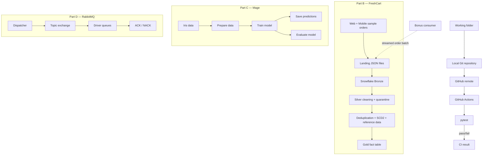

# From Git to Gold — Data Engineering Assignment

This repository contains the implementation for Parts A–D of the assignment.

## Project layout

- `elt/`: FreshCart ELT notebook (Snowflake)
- `iris_project/`: Mage Iris pipeline
- `stream/`: RabbitMQ dispatcher and driver
- `tests/`: pytest checks used by GitHub Actions
- `.github/workflows/ci.yml`: CI workflow

## Architecture



## Run locations

- Git commands and local pytest: VS Code terminal / PowerShell.
- FreshCart: Google Colab, connected to your own Snowflake account.
- Mage: Google Colab, using the Python 3.12 environment in the Mage reference notebook.
- RabbitMQ: Google Colab with a local RabbitMQ service, or a hosted AMQP broker.

Never commit passwords, broker URLs, `.env` files, or generated data files.

## First local test

```bash
python -m pip install -r requirements.txt
python -m pytest -q
```

See the assignment PDF for the required experiments and screenshots. Keep screenshots in a separate `evidence/` folder locally; add them to the report appendix later, not to the code folders unless requested.
